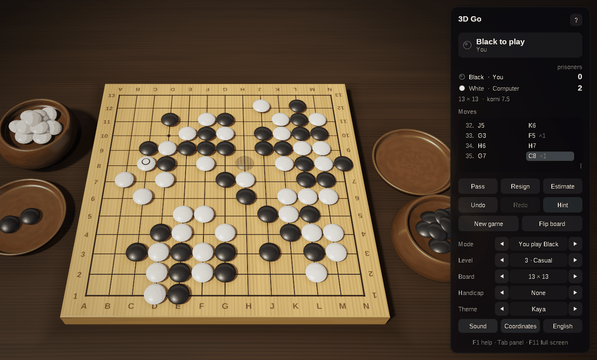
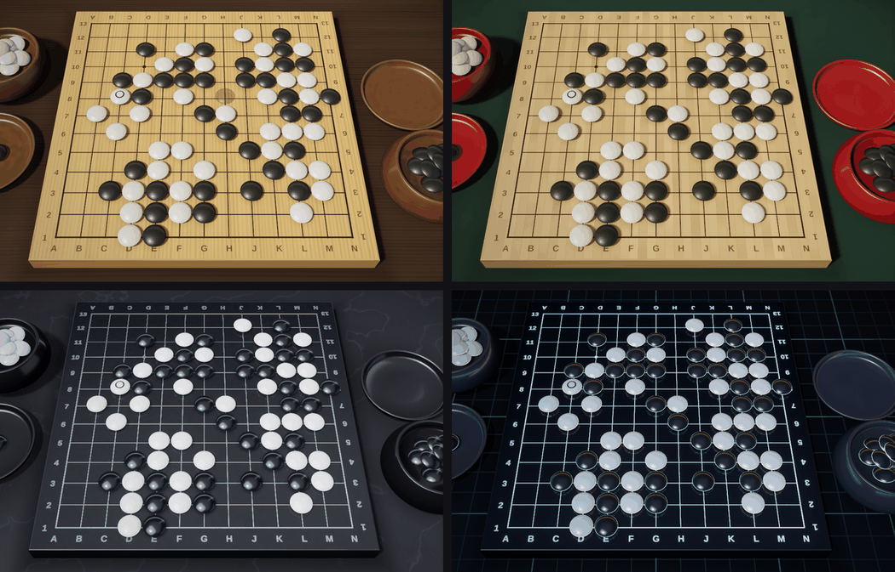

# 3D Go — C++23, SDL2 and OpenGL 4.6 for Linux

[](https://github.com/sponsors/makarov-mm)
[](LICENSE)


[](https://www.linkedin.com/in/makarov-mm/)
[](https://www.threads.net/@m.m.makarov)
[](https://www.instagram.com/m.m.makarov/)

A 3D game of Go for Linux written in modern C++ on SDL2 and OpenGL 4.6.

There is no game engine and no model, texture or sound file: the stones, the bowls and their lids are turned on a lathe in code at startup, the wood, slate, shell and glass are procedural, the lighting environment is baked on the GPU, and the sounds are synthesized. The only libraries are the ones every Linux desktop has: SDL2 for the window, the input and the sound, FreeType and fontconfig for the text. The shaders and the icon are built into the executable, so the game is a single file.





## Features

### Rules

- Boards of 9×9, 13×13 and 19×19, with handicaps of 2 to 9 stones (5 on 9×9) on the usual points
- Captures, the ko rule and positional superko; suicide is not allowed
- Area (Chinese) scoring with komi 7.5, or 0.5 with a handicap; two passes in a row end the game
- Counting: the dead stones are found by the computer and can be corrected with a click on a group; the territory is marked with squares, and the score is kept up to date. The count is accepted, or the game is played on
- Resignation, with a second click to confirm
- The points are named as on a printed board: columns `A`–`T` without `I`, rows from 1 at Black's side

### Play

- A computer opponent with five levels, from Novice to Master: Monte Carlo tree search with RAVE and priors, playouts that answer ataris, take stones, follow 3×3 shapes and leave eyes alone, several threads, and the empty corners first on the big boards. It passes when nothing is left to gain, and resigns a hopeless game. It thinks in the background, so the window stays responsive
- Play Black, play White, two players on one computer, or watch a demo game
- A see-through stone shows where a click would play; the stones it would take rise a little and glow. A point where ko forbids a retake is marked
- Undo and redo, the move list with the stones each move took, the prisoners of each side
- Hints, with the suggested point ringed; an estimate of the score, with the territory and the stones that look dead shown on the board
- Copy the game as SGF and paste an SGF game to continue it (its main line, with the size, komi, handicap and setup stones)
- The game in progress, the settings and the window's size are kept between sessions
- English and Russian interface, chosen from the system language
- An about card with the author and links to his pages, which open in the browser
- Sound effects, mixed so that they can play over each other
- Full screen; the interface follows the desktop's scaling (X11's `Xft.dpi`, as Cinnamon, GNOME, KDE and Xfce set it, or the output scale on Wayland)
- Shortcuts work in any keyboard layout: by their letters in Latin layouts, by their places in others, such as the Russian one
- No work while nothing moves: the game waits for input instead of drawing the same picture

### Graphics

- Physically based shading: GGX highlights, a clear lacquer coat, light passing through thin stone edges, image-based lighting from a procedural studio environment
- Soft shadows (PCSS), the shade round stones on the board and round the feet of the bowls, and the stones reflected in the polished boards
- HDR rendering with 4× MSAA, bloom, ACES tone mapping, vignette and dithering
- Smooth edges everywhere: multisampling for the outlines, and the lines, the hoshi, the coordinates and the marks drawn by the shaders filtered over each pixel; highlights widen where the surface curves within a pixel, so they do not sparkle
- Stones shaped as Japanese stones are cut, both faces domed, drawn hundreds at once with instancing; each has its own grain, so no two look alike
- Animation: a stone rises from the player's bowl and flies to its point, then the stones it takes fly into the lid of the player who took them; a move taken back runs the other way, and a new game dissolves in
- Four themes: Kaya with slate and shell stones, Bamboo with Chinese yunzi stones, Glass, and Neon
- An interface of frosted-glass panels, sharp at any screen scale

## Controls

| Action | Control |
|---|---|
| Place a stone; mark a group dead or alive when counting | Click a point |
| Turn the view | Drag with either mouse button |
| Zoom | Mouse wheel |
| Take back / replay a move | `Ctrl+Z` / `Ctrl+Y`, `←` / `→`, `Backspace` |
| Pass | `P` |
| Hint | `H` |
| Estimate the score | `E` |
| Accept the count | `Enter` |
| New game | `N` |
| Flip the board | `F` |
| View from above | `V` |
| Reset the view | `Home` |
| Computer level | `1` … `5` |
| Who plays whom | `M` (`Shift+M` back) |
| Board size | `B` (`Shift+B` back) |
| Coordinates on / off | `C` |
| Next theme | `T` (`Shift+T` back) |
| Sound on / off | `S` |
| English / Russian | `L` |
| Show / hide the panel | `Tab` |
| Full screen | `F11`, `Alt+Enter` |
| Copy the game (SGF) | `Ctrl+C` |
| Paste a game (SGF) | `Ctrl+V` |
| Help | `F1` |
| About the game and its author | `A` |
| Leave full screen | `Esc` |

The board size and the handicap apply at once to a game not yet begun or already over, and otherwise to the next game.

## Requirements

- Linux Mint 22 or newer, Ubuntu 24.04 or newer, or another distribution with GCC 13 or newer (or Clang 19 or newer), CMake 3.20 or newer and SDL 2.0.18 or newer
- An X11 desktop, or a Wayland one (through XWayland or natively)
- A graphics card and driver with OpenGL 4.6 (4.5 is enough): Mesa for Intel and AMD, or the NVIDIA driver

## Building and running

On Linux Mint, Ubuntu or Debian, install the compiler and the libraries:

```sh
sudo apt install build-essential cmake libsdl2-dev libfreetype-dev libfontconfig-dev libpng-dev libx11-dev
```

Then build and run in the project's folder:

```sh
cmake -S . -B build -DCMAKE_BUILD_TYPE=Release
cmake --build build -j
./build/go3d
```

To have the game in the applications menu, install it (to `/usr/local` by default):

```sh
sudo cmake --install build
```

The settings and the game in progress are kept in `~/.config/go3d/go3d.ini`.

## Project structure

```text
.
├── assets/                the icon and the menu entry (go3d.desktop)
├── cmake/Embed.cmake      builds the shaders and the icon into the executable
├── shaders/               GLSL shaders
├── src/
│   ├── Main.cpp           entry point
│   ├── App.*              the window, game flow, input and interface
│   ├── Go.*               the rules: strings and liberties kept move by move, ko and superko, scoring, SGF
│   ├── Engine.*           the computer player: Monte Carlo tree search, playouts and the estimate of the score
│   ├── StoneModel.*       the stone, turned on a lathe
│   ├── BoardGeometry.*    the layout for each size, and meshes of the board, the table, the bowls and the lids
│   ├── BoardView.*        the stones on the board, in the bowls and in the lids, and their animation
│   ├── Camera.*           orbit camera and mouse rays
│   ├── Renderer.*         the rendering pipeline
│   ├── Themes.*           materials and lighting of the themes
│   ├── Gl.*               OpenGL context (SDL) and functions
│   ├── Text.*             font atlases and the board's coordinates drawn with FreeType from the fonts fontconfig finds
│   ├── UiPainter.*        drawing of the interface
│   ├── Sound.*            synthesized sound effects, mixed on the audio device
│   ├── Settings.*         the settings file
│   ├── Strings.*          English and Russian texts
│   ├── Desktop.*          the desktop's scaling (Xft.dpi) and the window icon
│   ├── Resources.*        access to the files built into the executable, and the icon decoded
│   └── MathTypes.h        vectors and matrices
└── CMakeLists.txt
```

## How a frame is drawn

1. **Shadow map** — the board, the bowls and the stones seen from the key light, for soft shadows; the stones in one instanced draw.
2. **Reflection** — the stones over the board mirrored under it, drawn at half resolution and blurred into mipmaps, so the polish of each theme can show a sharper or softer reflection.
3. **Main pass** — the table, the board, the bowls and the stones in HDR with 4× MSAA, lit by the key light and the baked environment. The lines, the hoshi, the coordinates and the marks of each point (territory, ko, hint) are drawn by the board's shader from a small texture of the points; the stones are drawn in one instanced call for each color, and the see-through ones, sorted, last.
4. **Post-processing** — the samples are resolved, bright parts spread into a six-level bloom, and the composite pass applies tone mapping and vignetting and frosts the glass behind the interface panels.
5. **Interface** — panels, text and icons, drawn on top.

The environment maps are baked with compute shaders when the theme changes, and the BRDF table once at startup.

## License

MIT License

Copyright (c) 2026 Mykhailo Makarov

Permission is hereby granted, free of charge, to any person obtaining a copy
of this software and associated documentation files (the "Software"), to deal
in the Software without restriction, including without limitation the rights
to use, copy, modify, merge, publish, distribute, sublicense, and/or sell
copies of the Software, and to permit persons to whom the Software is
furnished to do so, subject to the following conditions:

The above copyright notice and this permission notice shall be included in all
copies or substantial portions of the Software.

THE SOFTWARE IS PROVIDED "AS IS", WITHOUT WARRANTY OF ANY KIND, EXPRESS OR
IMPLIED, INCLUDING BUT NOT LIMITED TO THE WARRANTIES OF MERCHANTABILITY,
FITNESS FOR A PARTICULAR PURPOSE AND NONINFRINGEMENT. IN NO EVENT SHALL THE
AUTHORS OR COPYRIGHT HOLDERS BE LIABLE FOR ANY CLAIM, DAMAGES OR OTHER
LIABILITY, WHETHER IN AN ACTION OF CONTRACT, TORT OR OTHERWISE, ARISING FROM,
OUT OF OR IN CONNECTION WITH THE SOFTWARE OR THE USE OR OTHER DEALINGS IN THE
SOFTWARE.

## Support

If you found this project interesting or useful, you can support my work:

[](https://github.com/sponsors/makarov-mm)
